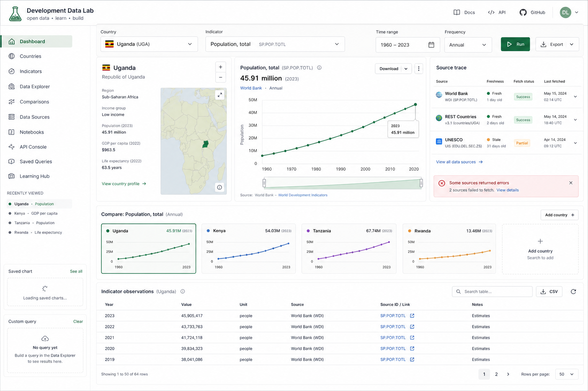

# Development Data Lab

Development Data Lab is an open-source learning dashboard for exploring public country development indicators. It helps learners inspect country profiles, indicator time series, source status, comparison views, and raw observations from public data APIs.



## Features

- Country dashboard with profile details, source-aware metrics, and a time-series chart.
- Indicator explorer for World Bank development indicators.
- East Africa comparison cards for Uganda, Kenya, Tanzania, and Rwanda.
- Raw observation table with source IDs and links.
- Source status page that separates live, optional, and inactive data sources.
- Frontend-only mode by default, with an optional FastAPI backend for typed proxy and enrichment endpoints.

## Quick Start

```bash
npm install
npm run dev
```

Open http://localhost:5173.

The frontend works without a backend. It fetches World Bank indicators directly and uses a small bundled country catalog for reliable learner workflows.

## Optional Backend

The FastAPI backend adds typed endpoints for country metadata, World Bank indicators, source status, and optional WHO data.

```bash
cd dashboard-backend
python -m venv .venv
source .venv/bin/activate
pip install -r requirements.txt
uvicorn main:app --reload
```

In another terminal:

```bash
cp .env.example .env
npm run dev
```

The app will use `VITE_API_BASE_URL=http://localhost:8000` when the variable is set.

## Data Sources

- World Bank World Development Indicators: active primary source for the default indicators.
- Bundled country catalog: local metadata used in frontend-only mode.
- REST Countries: optional backend enrichment for country metadata.
- WHO Global Health Observatory: optional backend endpoint for allowlisted health indicators.
- UNESCO UIS: inactive until the endpoint is revalidated.

## Scripts

```bash
npm run dev       # Start the Vite development server
npm run build     # Type-check and build production assets
npm run test      # Run frontend tests
npm run preview   # Preview the production build
```

Backend checks:

```bash
cd dashboard-backend
pytest
```

## Repository Name

The recommended repository slug is `development-data-lab`.

## Contributing

Contributions are welcome. Start with `CONTRIBUTING.md`, keep data-source claims verifiable, and include tests for data adapter or API behavior changes.

## License

MIT
